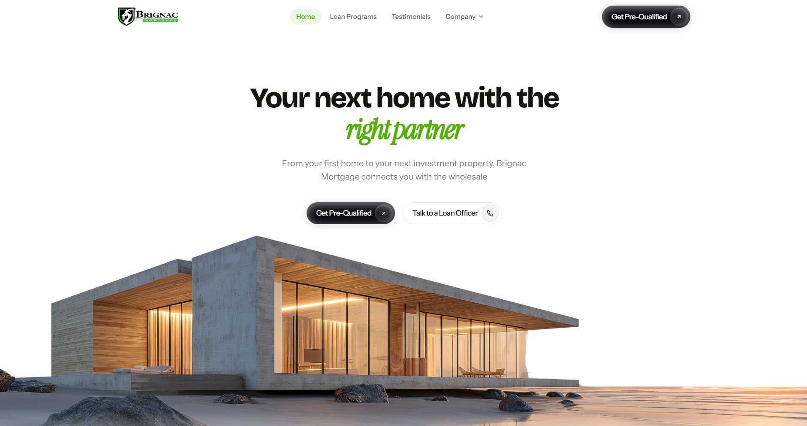

# Brignac Mortgage



Marketing site and admin dashboard for Brignac Mortgage, a Louisiana wholesale mortgage broker. Captures leads from the public site, tracks campaign/ad performance, and gives the team an AI assistant to query their own data.

## Stack

- **Backend:** Laravel 13, Fortify (email + password auth), Socialite
- **Frontend:** Inertia.js v3, React 19, Tailwind CSS v4
- **Testing:** Pest

## Features

- Public marketing site: loan programs, lead capture form, testimonials, legal pages
- Campaign/UTM tracking, CTA click tracking, geolocation on leads
- Admin dashboard: leads, campaigns, analytics, pixel/tracking settings, Excel export
- AI assistant for the dashboard (answers questions about the site's own data plus general mortgage/marketing knowledge)
- Email notifications on new leads (confirmation to the lead, notification to the team)

## Setup

```bash
composer run setup   # composer install, .env, app key, migrate, npm install, npm run build
```

Then fill in `.env` with real values for `MAIL_*`, `OPENAI_API_KEY`, `LEAD_NOTIFICATION_EMAILS`, and any tracking pixel IDs you need locally.

## Development

```bash
composer run dev   # serves PHP, queue listener, and Vite together
```

## Testing

```bash
php artisan test --compact
```

## Code style

```bash
vendor/bin/pint --dirty    # PHP
npm run lint                # ESLint
npm run format               # Prettier
npm run types:check          # TypeScript
```
